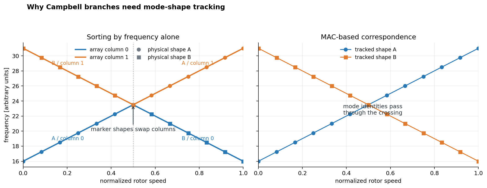

# Chapter 10 -- Solvers

Spinniped solves the equations of motion of a shaft or rotor after assembly
and application of the supports. This chapter explains the calculation
performed by each analysis and how to interpret its results. Example calls
are given in the [user manual](../user-manual/06_analyses.md).

## Table of contents

- [Equations and notation](#equations-and-notation)
- [Applying support constraints](#applying-support-constraints)
- [Modal analysis](#modal-analysis)
- [Campbell analysis](#campbell-analysis)
- [Frequency response](#frequency-response)
- [Unbalance response](#unbalance-response)
- [Time response](#time-response)
- [Mode correspondence](#mode-correspondence)
- [Critical-speed detection](#critical-speed-detection)
- [Result arrays](#result-arrays)
- [Numerical settings](#numerical-settings)

## Equations and notation

The assembled rotor equation is

$$
M\ddot q+\left[C(\Omega)+\Omega G\right]\dot q+K(\Omega)q=f(t).
$$

Here $M$ is the mass matrix, $K$ the stiffness matrix, $C$ the damping
matrix, and $G$ the gyroscopic matrix per unit rotor speed. The vector $q$
contains nodal translations and rotations.

Two frequencies must be distinguished:

- $\Omega$ is the signed **rotor speed**, supplied in rad/s.
- $\omega$ is the **forcing angular frequency**, also in rad/s.
  Its value in Hz is $f=\omega/(2\pi)$.

They are independent in an ordinary frequency-response calculation. For
unbalance, $\omega=|\Omega|$; for an order-$h$ synchronous load,
$\omega=h|\Omega|$.

For convenience, write

$$
D(\Omega)=C(\Omega)+\Omega G.
$$

This is the total matrix multiplying velocity, including the gyroscopic
contribution. Below, $M$, $K$, and $D$ refer to the matrices after support
constraints have been applied.

| Analysis | Engineering purpose | Calculation |
| --- | --- | --- |
| Modal | Undamped natural frequencies and mode shapes | Symmetric eigenvalue problem |
| Campbell | Damped frequencies and growth rates versus rotor speed | Complex eigenvalue problem at each speed |
| Frequency response | Steady motion under harmonic force | Direct dynamic-stiffness solve |
| Unbalance response | Steady motion under rotating mass eccentricity | Synchronous dynamic-stiffness solve |
| Time response | Motion from applied force and initial conditions | Time integration |

For a stochastic model, the solver repeats the same calculation for each
realization, using that realization's matrices and loads. It does not average
the matrices before solving. A deterministic model has one realization.

Speed-dependent coefficients are evaluated over the requested operating
speeds before the analysis starts. A request outside a table's range raises
an error; the solver does not extrapolate.

## Applying support constraints

Single-point constraints remove prescribed components from the unknown
displacements. Indices 0, 1, 2 are translations and 3, 4, 5 are rotations,
expressed in the grid's coordinate system.

At a constrained grid, the solver first rotates translations and rotations
into that grid frame. It then removes the constrained components. Let $B$
contain the free coordinate directions. The equations for the free DOFs and
the relation to displacements in global coordinates are

$$
q_{\mathrm{global}}=Bq,\qquad
M_{\mathrm{free}}=B^TMB,\qquad
K_{\mathrm{free}}=B^TKB,\qquad f_{\mathrm{free}}=B^Tf.
$$

The same transformation applies to damping and gyroscopic matrices. Loads
and displacements therefore use the same coordinate convention.

The result field `reduction_basis` contains $B$, which maps displacements
at the free DOFs to global coordinates. `free_dofs` lists the
retained indices in the working nodal coordinate system. At a rotated support,
these indices need not be global Cartesian components.

A full input vector is expressed in the support coordinate systems, and its
constrained components are removed. An input vector containing only free
components must already use the free-DOF order. Repeated constraints are
combined, and at least one DOF must remain free.

## Modal analysis

Modal analysis finds the undamped natural frequencies and mode shapes at
one operating point. It neglects damping and gyroscopic forces:

$$
M\ddot q+K(\Omega)q=0.
$$

Assuming harmonic free motion gives

$$
K(\Omega)\phi=\lambda M\phi,\qquad
\lambda=\omega_n^2,\qquad
f_n=\frac{\sqrt{\lambda}}{2\pi}.
$$

The scalar `speed` selects the stiffness when bearing coefficients depend
on rotor speed. It does not introduce gyroscopic splitting in this analysis.

### Solution method

The mass and stiffness matrices for the free DOFs must be symmetric. The
mass matrix must also be positive definite. The solver uses a Cholesky factorization to turn the
generalized eigenproblem into a standard symmetric problem:

$$
M=LL^T,\qquad
H=L^{-1}KL^{-T},\qquad
Hy=\lambda y,\qquad
\phi=L^{-T}y.
$$

Triangular solves apply these transformations. The symmetric problem is
solved with `scipy.linalg.eigh`.

With `modes=m`, the solver initially extracts the lowest $m$ eigenvalues.
If zero roots occupy some of those positions, it extends the range until
$m$ positive modes are available. With `modes=None`, it calculates all
positive modes.

Zero roots are removed using `zero_tolerance`. Significant negative
eigenvalues raise an error because they indicate negative stiffness in a
displacement direction. The smallest eigenvalue is included in the search,
so this check is retained when only a few modes are requested.

### Meaning of the results

The returned shapes are mass-normalized:

$$
\phi_i^TM\phi_j=\delta_{ij}.
$$

Their scale is a numerical convention; it is not the displacement amplitude
under a particular load. Their overall sign is arbitrary.

`eigenvalues` contains $\omega_n^2$ in $\mathrm{s}^{-2}$.
`frequencies` contains $f_n$ in Hz, and `eigenvectors` contains the free-DOF
displacement shapes.

For stochastic models, shape matching can keep the mode labels consistent
between realizations; see [Mode correspondence](#mode-correspondence).
Nonsymmetric stiffness, such as some cross-coupled bearing models, requires
the Campbell analysis instead.

A partial request saves the calculation of unused mode shapes. The mass
factorization and matrix transformation are still dense operations.

## Campbell analysis

Campbell analysis calculates how the damped modes change with rotor speed.
At each supplied speed it solves

$$
M\ddot q+D(\Omega)\dot q+K(\Omega)q=0.
$$

For motion of the form $q(t)=\phi e^{\lambda t}$,

$$
\left[\lambda^2M+\lambda D(\Omega)+K(\Omega)\right]\phi=0.
$$

The eigenvalue is generally complex. Write $\lambda=\alpha+i\beta$. Then

$$
q(t)=\operatorname{Re}\{\phi e^{\alpha t}e^{i\beta t}\},\qquad
f_d=\frac{|\beta|}{2\pi}.
$$

The imaginary part gives the damped oscillation frequency. The real part
gives the growth or decay rate: $\alpha<0$ means decay and $\alpha>0$
means growth. A damping ratio can be calculated as
$\zeta=-\alpha/|\lambda|$; it is not a separate returned field.

### State formulation

The solver introduces displacement and velocity as separate unknowns:

$$
x=\begin{bmatrix}q\\\dot q\end{bmatrix},\qquad
\dot x=Ax,\qquad
A=\begin{bmatrix}0&I\\-M^{-1}K&-M^{-1}D\end{bmatrix}.
$$

Each eigenvector has the form $[\phi;\lambda\phi]$. This doubles the matrix
size, and the resulting problem is generally nonsymmetric. It therefore
needs a general eigensolver rather than the symmetric modal solver.

### Partial eigenvalue extraction

The calculation has two parts: guide the search towards the required roots,
then find those roots by iteration. The following steps explain both parts.

#### 1. Set the number of roots to calculate

With $n$ free DOFs, the state problem has $2n$ eigenvalues. A request for
$m$ vibration modes does not require all of them. Spinniped asks the
iterative solver for

$$
k=\min\left(2(m+1),\,2n-2\right)
$$

state roots. The factor of two accounts for conjugate pairs. One extra pair
allows for real roots that may appear in the same search region.

For example, a model with 100 free DOFs has 200 state eigenvalues. A request
for six modes asks for 14 state roots. After the solve, conjugate partners
and nonoscillating roots are removed, and six oscillating modes are retained
if enough are available.

#### 2. Guide the search near a chosen point

The numerical search target is $\sigma=-1\,\mathrm{s}^{-1}$ on the real axis
of the complex eigenvalue plane. Roots are considered close to this point
when $|\lambda-\sigma|$ is small. This is not a forcing frequency.

To favour these roots, the solver works with the inverse operation

$$
T=(A-\sigma I)^{-1}.
$$

If a state mode $z$ satisfies $Az=\lambda z$, the same vector satisfies

$$
Tz=\mu z,\qquad \mu=\frac{1}{\lambda-\sigma}.
$$

Thus, roots near the search target become eigenvalues of $T$ with large
magnitude. Spinniped asks `scipy.sparse.linalg.eigs` to find those large
eigenvalues. This transformation is called **shift-invert**.

The target is near zero to find low-frequency modes. Placing it at $-1$
rather than exactly zero avoids trying to invert at a possible rigid-body
root at zero. A root exactly at the chosen target can still make the
calculation singular.

#### 3. Find a few modes by iteration

The iterative solver starts with a trial vector and repeatedly applies $T$.
From these calculations it builds a limited set of independent working
vectors. It uses that set to form a smaller eigenvalue problem and refines
the estimates of the requested roots until they converge.

For the six-mode example above, the working set contains up to 43 vectors,
instead of solving the complete 200-by-200 state eigenproblem. All 100 free
DOFs still participate in each working vector; no physical DOFs are omitted.
The working-set size is specified under [Numerical settings](#numerical-settings).

For this procedure, the eigensolver only needs a way to calculate $Tr$ for
any trial vector $r$. It does not need the entries of the inverse matrix $T$.

#### 4. Calculate the inverse operation with a linear solve

Applying $T$ means solving

$$
(A-\sigma I)y=r.
$$

Split the input and output into two blocks, following the displacement and
velocity positions in the state vector:

$$
r=\begin{bmatrix}u\\v\end{bmatrix},\qquad
y=\begin{bmatrix}y_q\\y_v\end{bmatrix}.
$$

Each block has $n$ entries. Here $u$ and $v$ are the two halves of a trial
vector supplied by the eigensolver. The quantities $y_q$ and $y_v$ are the
two halves returned by the inverse operation. They are temporary vectors
used during iteration, not an applied load or a calculated forced response.
The subscripts indicate their positions in the state vector.

Using the block form of $A$, the linear system becomes

$$
y_v-\sigma y_q=u,
$$

$$
-Ky_q-(D+\sigma M)y_v=Mv.
$$

The first equation gives $y_v=u+\sigma y_q$. Substitute this into the second
equation to obtain a system involving only $y_q$:

$$
\underbrace{(K+\sigma D+\sigma^2M)}_{P}\,y_q
=-Mv-(D+\sigma M)u.
$$

The solver factors the $n\times n$ matrix $P$ once by LU decomposition.
For each trial vector, it forms the right-hand side, solves for $y_q$ with
that same factorization, and calculates $y_v=u+\sigma y_q$. It returns the
combined vector $[y_q;y_v]$ to the eigensolver.

This supplies every inverse operation required by the iteration using the
original structural matrix size. Neither the full state matrix $A$ nor the
inverse matrix $T$ is built on this path. The LU factorization is still a
dense calculation, so the cost is not proportional to the mode count alone.

#### 5. Return the original state roots

The iterative solver returns $\mu$ and its eigenvectors. Spinniped converts
each root back using

$$
\lambda=\sigma+\frac{1}{\mu}.
$$

The eigenvectors also belong to the original state problem. The solver then
selects the oscillating roots and orders or tracks the requested modes, as
described below.

There is one iterative eigensolve with the fixed root count $k$. The solver
does not automatically increase that count or switch methods after a
failure. Factorization and convergence errors are reported to the caller.

### Full-spectrum state solution

For `modes=None`, or a request covering all free DOFs, the solver forms the
state matrix and uses `scipy.linalg.eig`. The blocks $M^{-1}K$ and $M^{-1}D$
are obtained by solving mass-matrix equations. No explicit mass inverse is
formed. Only right eigenvectors are calculated.

### Which roots are returned?

The solver keeps one root from each oscillating conjugate pair: the root
with positive imaginary part. Purely real roots and numerical zero roots
are excluded, including when `modes=None`.

The partial method finds roots near the search target and then orders them
by oscillation frequency. With strong damping, these need not be the
lowest-frequency roots of the full problem. Use `modes=None` to calculate
the full spectrum before selecting the oscillating branches.

Real or rigid roots can occupy part of the partial search. If too few
oscillating modes are found, the requested count cannot be returned.

`eigenvectors` contains displacement followed by velocity. These state
vectors are normalized by the eigensolver; their displacement portions are
not mass-normalized as in modal analysis. Unstable oscillating roots are
returned as calculated, so stability assessment requires examining the
real parts of the selected eigenvalues.

Speeds are processed in the supplied order. With tracking enabled, shape
matching follows each branch between speeds and then aligns stochastic
realizations with sample 0.

## Frequency response

Frequency response calculates the steady vibration amplitude under a
specified harmonic force. Use complex peak amplitudes, or phasors:

$$
f(t)=\operatorname{Re}\{\widehat f e^{i\omega t}\},\qquad
q(t)=\operatorname{Re}\{\widehat q e^{i\omega t}\}.
$$

Substitution into the equation of motion gives

$$
Z(\omega,\Omega)\widehat q=\widehat f,\qquad
Z=K(\Omega)-\omega^2M+i\omega\left[C(\Omega)+\Omega G\right].
$$

The dynamic stiffness $Z$ combines elastic, inertial, damping, and
gyroscopic forces at the specified frequency.

### Solution method and loading

For ordinary harmonic loading, rotor speed is fixed and forcing frequency
is swept independently. Each point is a direct complex linear solve using
`numpy.linalg.solve`. No mode shapes are calculated or used in the response
calculation.

Supply exactly one of the following:

- `force`: a complex vector in full global or free-DOF order, shared by all
  realizations and forcing frequencies.
- `load_ids`: selected `HarmonicLoad` or `RotatingLoad` records. Their
  amplitudes and phases are assembled separately for each realization.

For load records, local forces and moments are rotated into global
coordinates and added at their grids. The solver then expresses the forces
along the free coordinate directions. Amplitude tables are evaluated at rotor speed, not forcing
frequency. The [load-record chapter](06_load_records.md) gives the phasor
and coordinate conventions.

### Order-locked frequency response

With `SynchronousLoad`, forcing frequency follows rotor speed:

$$
\omega=h|\Omega|,\qquad f=\frac{h|\Omega|}{2\pi}.
$$

The same dynamic-stiffness equation is solved, using one frequency for
each supplied speed. All selected records must have the same positive order
$h$. They cannot be mixed with ordinary harmonic or rotating records in
one call, and the caller must omit `frequencies`.

At each point, both structural coefficients and load amplitudes are
evaluated at the signed rotor speed.

### Meaning of the response

`response` contains displacement phasors. For
$\widehat q_j=Ae^{i\theta}$, the component motion is
$A\cos(\omega t+\theta)$:

- $|\widehat q_j|$ is the peak amplitude.
- $\arg(\widehat q_j)$ is the phase in radians.
- $i\omega\widehat q$ and $-\omega^2\widehat q$ give velocity and
  acceleration phasors if needed.

For a nonzero-frequency sinusoid, RMS amplitude is the peak divided by
$\sqrt{2}$. Global displacements are obtained from $B\widehat q$.

At zero forcing frequency, the calculation reduces to the static equation
$K(\Omega)\widehat q=\widehat f$. A singular static or dynamic stiffness
raises a linear-solve error. The result describes steady motion; startup
transients require time response.

## Unbalance response

Unbalance response calculates the steady vibration produced by an eccentric
rotating mass. For mass-eccentricity product $me$, the force magnitude and
frequency are

$$
F_u=me\Omega^2,\qquad \omega=|\Omega|.
$$

For positive rotation in an aligned load frame, one record gives

$$
\widehat f_{u,l}=me\Omega^2e^{i\varphi}
[1,-i,0,0,0,0]^T.
$$

The two transverse components are in quadrature and represent a circular
force. Reverse spin reverses its rotation. The solver also accounts for
a load frame whose z-axis is opposite to the model spin axis.

### Solution method

At each speed, the solver assembles the selected unbalance forces and solves

$$
\left[K(\Omega)-|\Omega|^2M
+i|\Omega|\left(C(\Omega)+\Omega G\right)\right]\widehat q_u
=\widehat f_u(\Omega).
$$

This is a direct complex linear solve, as in frequency response. The
difference is the excitation: both its frequency and magnitude depend on
rotor speed.

Force contributions are rotated into global coordinates and summed before
selection of the force components along the free directions. Their phases
therefore affect the combined response.
The implementation assembles one force coefficient for each spin direction
per realization, then scales the appropriate coefficient by $\Omega^2$ at
each speed.

`load_ids` must select only `Unbalance` records. The mass-eccentricity
product is constant within each realization; stiffness and damping may
depend on speed.

The returned `response` uses the same peak-amplitude convention as frequency
response. Rotor speed remains signed, while returned forcing frequencies
are $|\Omega|/(2\pi)$.

At zero speed the force is zero. The solver still performs the static
zero-load solve, so zero response requires nonsingular constrained stiffness.

## Time response

Time response calculates motion from given initial conditions under an
applied force. At one fixed rotor speed, it solves

$$
M\ddot q+D\dot q+Kq=f(t),\qquad
q(t_0)=q_0,\qquad \dot q(t_0)=v_0.
$$

The response includes both the free motion due to initial conditions and
the motion due to the applied force.

### Solution method

Displacement and velocity form the state $x=[q;v]$. At each evaluation of
the state derivative, the solver calculates

$$
Ma=f(t)-Dv-Kq,\qquad
\dot x=\begin{bmatrix}v\\a\end{bmatrix}.
$$

Acceleration is obtained by a direct mass-matrix solve. The state is then
advanced with `scipy.integrate.solve_ivp`, using the default adaptive RK45
Runge--Kutta method. All free physical DOFs are integrated; no modal
truncation is applied.

The mass equation is solved at every evaluation. The current implementation
does not reuse a mass factorization.

### Loads, initial conditions, and output times

`force` is a real constant vector or a callback `force(time)`. Full global
and free-DOF vectors are accepted. A callback must provide force at any time
within the interval, because internal integration times generally differ
from the requested output times. Declarative load IDs are not used here.

`initial_state` contains the displacement block followed by the velocity
block. Both full global and free-DOF orders are accepted. For full input
blocks, the solver expresses displacement and velocity along the free
coordinate directions separately. If omitted, both initial displacement and velocity
are zero at `times[0]`.

The force input and initial state are shared by the realizations, while
each realization uses its own equation matrices.

`times` specifies where results are stored. It must be strictly increasing
and contain at least two points. It does not set the integration step size:
RK45 chooses internal steps to control its error.

Rotor speed, stiffness, and damping remain fixed during the integration.
A model with high natural frequencies can require many internal steps even
with widely spaced output times. Integrator settings are not exposed by
the current solver API. An unsuccessful integration raises `RuntimeError`
with the integrator's message.

`displacement` and `velocity` are real histories in the free-DOF order.
Translations use m and rotations rad; velocities use m/s and rad/s.
Multiplication by $B$ expresses these histories in global coordinates,
including the constrained components.

## Mode correspondence

Frequency order is not a permanent mode label. Two physical modes can cross
in frequency, so sorting at every point can swap their labels.

With `track_modes=True`, Spinniped compares displacement shapes using the
Modal Assurance Criterion:

$$
\operatorname{MAC}_{ij}
=\frac{|\phi_{r,i}^H\phi_{c,j}|^2}
{(\phi_{r,i}^H\phi_{r,i})(\phi_{c,j}^H\phi_{c,j})}.
$$

Here $r$ denotes a reference shape and $c$ a newly calculated shape.
A value near one indicates similar shapes; a value near zero indicates
poor agreement. The comparison uses the ordinary, unweighted displacement
vectors. The superscript $H$ means conjugate transpose.

The solver matches the modes one-to-one, choosing the assignment with the
largest total MAC. It then reorders eigenvalues and eigenvectors together.
For example, a match `[2, 0, 1]` places the third new mode in the first
result column, the first in the second, and the second in the third.

References are chosen as follows:

- **Modal:** every stochastic realization is matched to sample 0.
- **Campbell:** each speed is matched to the preceding speed in the same
  realization. After that sweep, each realization is aligned with sample 0
  at each speed.

Signs, or complex phases, are also aligned to avoid arbitrary flips between
matching shapes. Tracking changes the order and phase of the stored vectors;
it does not change the calculated eigenvalues.

  

*At a frequency crossing, shape-based matching can preserve the labels of
the two physical modes.*

Tracking is limited to the modes actually extracted. Request more modes if
a branch can move outside that range. Repeated frequencies and large speed
increments can also make individual matches ambiguous.

At zero speed, an axisymmetric rotor can have coincident forward- and
backward-whirl frequencies. Their separate shapes are not uniquely defined
there. Starting at a small nonzero speed can establish clearer labels, as
discussed in the
[user manual](../user-manual/06_analyses.md#starting-a-symmetric-stochastic-sweep-near-zero).
The solver warns when a tracked sweep starts at exactly zero speed.
If the requested count cuts through a repeated pair, either member may
define the branch followed after the pair separates.

## Critical-speed detection

With `harmonics`, the Campbell solver finds intersections between a tracked
mode frequency and an order line:

$$
g_i=f_d(\Omega_i)-\frac{h\Omega_i}{2\pi}.
$$

A sampled point with $g_i$ sufficiently close to zero is stored as a
crossing. When two adjacent residuals have opposite signs, the crossing
speed is estimated by linear interpolation:

$$
\Omega_*=\Omega_i-g_i
\frac{\Omega_{i+1}-\Omega_i}{g_{i+1}-g_i}.
$$

No additional eigensolution is performed at $\Omega_*$. Accuracy therefore
depends on the supplied speed spacing and the curvature of the branch.
The calculation requires tracking and at least two strictly increasing
speeds.

The order line uses signed $\Omega$. For negative speeds it differs from
the positive forcing-frequency line $h|\Omega|/(2\pi)$ used by synchronous
response calculations.

Multiple crossings are retained in ascending speed order.
`critical_speed_counts` records how many were found; unused entries in
the crossing arrays are filled with `NaN`.

## Result arrays

The sample index is $s=0,\ldots,n_s-1$, where $n_s$ is the total number of
samples. Let $n$ be the free DOF count and $m$ the returned mode count.
Every result keeps the sample axis, even when $n_s=1$.

| Analysis | Main arrays and their shapes |
| --- | --- |
| Modal | `eigenvalues`, `frequencies`: $(n_s,m)$; `eigenvectors`: $(n_s,n,m)$ |
| Campbell | `eigenvalues`, `frequencies`: $(n_s,n_\Omega,m)$; `eigenvectors`: $(n_s,n_\Omega,2n,m)$ |
| Frequency response | `response`: $(n_s,n_f,n)$; `frequencies`: $(n_f,)$ |
| Unbalance response | `response`: $(n_s,n_\Omega,n)$; `frequencies`: $(n_\Omega,)$ |
| Time response | `displacement`, `velocity`: $(n_s,n_t,n)$; `times`: $(n_t,)$ |

For synchronous frequency response, $n_f$ is the number of supplied speeds.
Campbell vectors contain displacement first and velocity second. Apply $B$
to each half separately to express displacement and velocity in global coordinates.

Critical-speed arrays have shape
$(n_s,n_h,m,n_c)$, where $n_c$ is the largest crossing count in the result.
The count array has shape $(n_s,n_h,m)$.

All analyses return `analysis`, `free_dofs`, `reduction_basis`, `samples`,
and `stochastic`. Steady-response calculations also report selected
`load_ids`; this tuple is empty for a raw force vector. Rotor-speed arrays,
where present, are returned in rad/s as `speeds` and divided by $2\pi$ as
`speeds_hz`.

An unavailable mode count or inconsistent number of modes between points
raises an error rather than producing arrays of unequal lengths.

## Numerical settings

These settings describe the current implementation. They are collected
here so the analysis descriptions can focus on the mechanical calculation.

| Calculation | Setting |
| --- | --- |
| Modal symmetry check | Relative tolerance $10^{-10}$, absolute tolerance $10^{-12}$ |
| Modal zero-root cutoff | $10\epsilon n\max(\lVert H\rVert_\infty,1)$, unless `zero_tolerance` is supplied |
| Partial Campbell extraction | Search target $\sigma=-1\,\mathrm{s}^{-1}$; eigensolver tolerance $10^{-10}$ |
| Partial Campbell iteration space | $\min(3k+1,2n)$ vectors for $k$ requested state roots |
| Partial Campbell zero-root cutoff | $\sqrt{\epsilon}\max(\max\vert\lambda\vert,1)$ on the extracted roots |
| Full Campbell imaginary-part cutoff | $10^{-8}\,\mathrm{s}^{-1}$ |
| Time integration | RK45; relative tolerance $10^{-3}$, absolute tolerance $10^{-6}$ |
| Critical-speed residual cutoff | $10\epsilon n_\Omega\max(\max_i\vert g_i\vert,1)$ |

$\epsilon$ is double-precision machine epsilon. The modal cutoff has units
of squared angular frequency. The Campbell cutoffs apply to state roots
in $\mathrm{s}^{-1}$.

Partial Campbell extraction starts from a fixed locally generated vector
for repeatability. It does not change the random sampling of the model.
The equation matrices for the free DOFs remain dense in all analyses.
