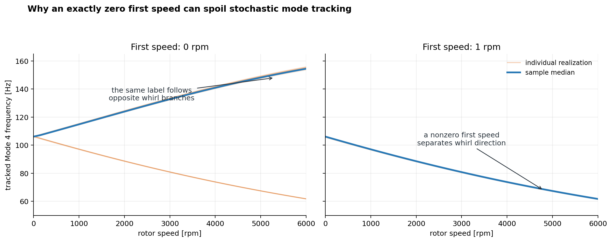

# Chapter 6 -- Analyses

## Table of contents

- [Boundary conditions](#boundary-conditions)
- [Choosing an analysis and reading common results](#choosing-an-analysis-and-reading-common-results)
- [Modal analysis](#modal-analysis)
  - [Modal equation and solution](#modal-equation-and-solution)
  - [Modal inputs and outputs](#modal-inputs-and-outputs)
- [Campbell analysis](#campbell-analysis)
  - [Campbell equation and solution](#campbell-equation-and-solution)
  - [Campbell inputs and root interpretation](#campbell-inputs-and-root-interpretation)
  - [Starting a symmetric stochastic sweep near zero](#starting-a-symmetric-stochastic-sweep-near-zero)
  - [Critical speeds from sampled Campbell branches](#critical-speeds-from-sampled-campbell-branches)
- [Frequency response](#frequency-response)
  - [Harmonic equation and solution](#harmonic-equation-and-solution)
  - [Order-locked synchronous loads](#order-locked-synchronous-loads)
- [Unbalance response](#unbalance-response)
  - [Unbalance equation and solution](#unbalance-equation-and-solution)
  - [Unbalance inputs and outputs](#unbalance-inputs-and-outputs)
- [Time response](#time-response)
  - [Time equation and solution](#time-equation-and-solution)
  - [Time inputs and interpretation](#time-inputs-and-interpretation)

`Solver.solve` is the single analysis entry point. Boundary conditions belong
to the model definition rather than to an individual solver call.

## Boundary conditions

Boundary conditions are declarative model records. Add them before building:

```python
from spinniped import ModelDefinition, SinglePointConstraint, Solver

definition = ModelDefinition(
    grids=grids,
    materials=materials,
    properties=properties,
    elements=elements,
    boundary_conditions=[
        SinglePointConstraint(grid=1, dof=(2, 5)),
    ],
)
model = ModelBuilder().build(definition)
solver = Solver(model)
result = solver.solve("modal", modes=8)
```

or to an individual call:

```python
solver = Solver()
result = solver.solve(
    "modal",
    model=model,
    modes=8,
)
```

Each `SinglePointConstraint` identifies a grid and zero or more local Python
DOF indices: translations are `0`, `1`, `2`, and rotations are `3`, `4`, `5`.
Omitting `dof` selects all six components; `dof=()` has no effect. Duplicate
components across separate SPC records are harmless. At least one model DOF
must remain free.

The components use the coordinate system selected by
`Grid.coordinate_system`. They are global only when that ID is `0`. For a
rotated grid frame, the solver first expresses that grid's translational and
rotational DOFs in its local frame and then removes the requested components.
This makes, for example, `dof=(0,)` constrain motion along the grid frame's x
axis without requiring the caller to calculate coupled global DOF indices.

The solver applies the support constraints automatically. Displacement and
mode-shape arrays contain the free components; `free_dofs` identifies their
positions in the model's DOF order. At a grid with a rotated support frame,
these components follow that frame's axes.

Every `speed` and `speeds` input is signed rotor angular speed in rad/s. When
the model contains `SpeedDependentValue` records, the solver interpolates all
required structural operating points before the first eigensolution, linear
solve, or time integration. It rejects the complete call if any point falls
outside a table's range.

## Choosing an analysis and reading common results

The analyses answer different questions. Select the route by the physical
quantity needed, rather than by the format of the input load alone.

| Question | Analysis | What is calculated |
| --- | --- | --- |
| What are the undamped natural frequencies and shapes? | `modal` | Positive eigenpairs of the stiffness and mass matrices for the free DOFs |
| How do damped frequencies and growth rates change with rotor speed? | `campbell` | Complex damped gyroscopic roots at each speed |
| What is the steady response at prescribed forcing frequencies? | `frequency_response` | Complex displacement amplitudes from direct linear solves |
| What is the steady response to an order-locked harmonic load? | `frequency_response` with `SynchronousLoad` | One response per speed with forcing frequency derived from the order |
| What is the synchronous response to rotating mass eccentricity? | `unbalance_response` | Complex displacement amplitudes under the $me\Omega^2$ force law |
| How does displacement evolve from initial conditions and a time load? | `time_response` | Real displacement and velocity histories |

Use the following notation throughout this chapter:

| Symbol | Meaning and input unit |
| --- | --- |
| $\Omega$ | Signed rotor speed, rad/s; the API names it `speed` or `speeds` |
| $\omega$ | Nonnegative forcing angular frequency, rad/s |
| $f$ | Forcing or vibration frequency, Hz, with $\omega=2\pi f$ |
| $q$ | Displacement at the free DOFs: translations in m and rotations in rad |
| $s$ | Sample index, starting at zero |
| $n_s$ | Number of samples; a deterministic model has $n_s=1$ |
| $n$ | Number of free DOFs after applying the model's support constraints |

For an input in rpm, convert using `speed_rpm * 2*np.pi/60`. The array
`speeds_hz`, where returned, is signed rotor speed divided by $2\pi$; it is
not necessarily the forcing frequency. For example, a 2x synchronous force
has frequency twice the absolute rotor frequency.

All response arrays keep the leading sample dimension. Index `[0]` selects
the only realization of a deterministic model. Stochastic calls solve each
realization with its own resolved properties and loads; they do not solve a
model made from averaged matrices. Means, standard deviations, and bands are
postprocessing of the resulting sample arrays.

Every analysis identifies its type, sample count, and free DOFs in the result.
You may supply loads in full global DOF order or supply only the free force
components. The solver handles the support constraints and coordinate
conversions. The [reference manual](../reference-manual/10_solvers.md#applying-support-constraints)
describes the internal transformations.

## Modal analysis

### Modal equation and solution

Modal analysis finds free vibration frequencies and shapes while omitting
damping and gyroscopic forces. At the chosen scalar operating speed,

$$
M\ddot q+K(\Omega)q=0,\qquad
K(\Omega)\phi=\lambda M\phi,\qquad
\lambda=\omega_n^2,\qquad
f_n=\frac{\sqrt{\lambda}}{2\pi}.
$$

The solver factors the mass matrix as $M=LL^T$, transforms the problem to
the symmetric matrix $L^{-1}KL^{-T}$, and calls the symmetric eigensolver
`scipy.linalg.eigh`. With `modes=m`, it requests the lowest candidate indices
and enlarges the range only if zero roots must be skipped. The resulting
shapes are transformed back and mass-normalized:

$$
\phi_i^T M\phi_j=\delta_{ij}.
$$

This method requires symmetric stiffness, symmetric mass, and positive
definite mass matrix for the free DOFs. Use Campbell analysis when cross-coupled stiffness is
nonsymmetric or when damping and gyroscopic effects are part of the question.

### Modal inputs and outputs

```python
result = solver.solve(
    "modal",
    modes=8,
    track_modes=True,
    speed=100.0,
)
```

| Option | Meaning |
| --- | --- |
| `modes` | Positive integer count of positive modes; default `None` requests all |
| `speed` | Scalar signed operating speed in rad/s, default `0.0` |
| `zero_tolerance` | Optional absolute cutoff on squared angular frequencies, in $\mathrm{s}^{-2}$ |
| `track_modes` | Default `True`; match stochastic samples to sample 0 by shape |

Result values include:

- `eigenvalues`: `(samples, modes)` values of $\omega^2$ in $\mathrm{s}^{-2}$;
- `frequencies`: `(samples, modes)` frequencies in Hz;
- `eigenvectors`: `(samples, free_dofs, modes)` mode shapes at the free DOFs;
- `speed`: the scalar rotor speed used to evaluate stiffness.

Eigenvalues within `zero_tolerance` of zero are treated as rigid modes and
removed. The default tolerance uses a matrix-norm bound on the eigenspectrum;
it may be overridden with a finite, nonnegative `zero_tolerance`. An eigenvalue
below the negative tolerance raises an instability or insufficient-constraint
error rather than being silently discarded.

The real modal route requires symmetric stiffness and mass matrices; use the
Campbell route when cross-coupled bearing coefficients make stiffness
non-symmetric. Damping and gyroscopic terms are not included in modal analysis.
The requested `modes` count is strict: requesting more positive modes than are
available raises an error.

Specifying `modes` requests a partial eigensolution rather than calculating all
mode shapes and discarding the rest. The index range grows only to skip zero
roots and obtain the requested number of positive modes. Omitting `modes`
calculates all positive modes. Tracking matches within the extracted modes.

`speed` defaults to `0.0`. It selects $\mathbf{K}(\Omega)$ when bearing
stiffness is speed-dependent, but it does not introduce damping or gyroscopic
terms into this real modal route. The selected speed must lie within every
stiffness table used by the model.

For stochastic models, `track_modes=True` (the default) matches every later
sample to sample zero by maximizing the Modal Assurance Criterion (MAC), then
aligns eigenvector signs. Set `track_modes=False` to retain independent
ascending-eigenvalue order in every sample.

For example, read the frequencies and first mode shape:

```python
frequencies_hz = result["frequencies"][0]
first_free_shape = result["eigenvectors"][0, :, 0]
```

An eigenvector describes relative shape, not the displacement amplitude under
a particular force. Its overall sign is arbitrary; mass normalization fixes
its scale for numerical use. No force or initial state is supplied to this
analysis. Since dense matrix transformation is still required, a small `modes`
count reduces eigensolution work but does not make the entire analysis sparse.

## Campbell analysis

### Campbell equation and solution

Campbell analysis includes damping and gyroscopic effects. At each signed
rotor speed it solves the unforced equation

$$
M\ddot q+\left[C(\Omega)+\Omega G\right]\dot q+K(\Omega)q=0.
$$

With $q(t)=\phi e^{\lambda t}$, the roots satisfy

$$
\left[\lambda^2M+\lambda(C(\Omega)+\Omega G)+K(\Omega)\right]\phi=0.
$$

The solver uses the equivalent displacement/velocity state $[q;\dot q]$,
which doubles the eigenproblem size. When only a few modes are requested,
the iterative eigensolver is guided to search near $-1\,\mathrm{s}^{-1}$
on the real axis of the complex eigenvalue plane. This numerical target is
close to zero to find low-frequency modes, while avoiding a search centred
exactly on a possible rigid-body root at zero. It is not a forcing frequency
or a rotor property.

The calculation uses the method known as shift-invert. It needs one
factorization of a matrix of the original structural size, without building
the doubled state matrix. The reference manual gives the transformation.
Full-spectrum requests use the dense general eigensolver `scipy.linalg.eig`.

### Campbell inputs and root interpretation

```python
result = solver.solve(
    "campbell",
    speeds=[0.0, 100.0, 200.0],  # rad/s
    modes=8,
    track_modes=True,
    harmonics=[1.0, 2.0],
)
```

| Option | Meaning |
| --- | --- |
| `speeds` | Required nonempty one-dimensional signed speeds in rad/s |
| `modes` | Positive integer count of oscillating branches; default `None` requests all |
| `track_modes` | Default `True`; match shapes between speeds and realizations |
| `harmonics` | Optional positive unique harmonic orders for sampled critical-speed detection |

For ordinary tracking, speeds are processed in the given order. Harmonic
crossing detection additionally requires at least two strictly increasing
speeds. The solve does not add intermediate speed points.

Its analysis-specific results are:

- `speeds`: the requested angular speeds in rad/s, shape `(speeds,)`;
- `speeds_hz`: those speeds divided by $2\pi$, shape `(speeds,)`;
- `eigenvalues`: complex state eigenvalues, shape
  `(samples, speeds, modes)`;
- `frequencies`: absolute imaginary parts in Hz, shape
  `(samples, speeds, modes)`;
- `eigenvectors`: complex state vectors, shape
  `(samples, speeds, 2*free_dofs, modes)`;
- `track_modes`: whether MAC-based branch tracking was enabled;
- `harmonics`: requested positive harmonic indices $h$, shape `(harmonics,)`;
- `critical_speeds`: interpolated angular speeds in rad/s, shape
  `(samples, harmonics, modes, crossings)`;
- `critical_speeds_hz`: the same values divided by $2\pi$;
- `critical_speed_counts`: number of crossings found for each sample,
  harmonic, and mode, shape `(samples, harmonics, modes)`.

Before entering the speed loop, the solver evaluates every bearing stiffness
and damping table over the complete `speeds` input. At each loop position it
uses $\mathbf{K}(\Omega_i)$ and $\mathbf{C}(\Omega_i)$ together with the fixed
mass and unit-speed gyroscopic matrices.

Specifying `modes=m` uses one iterative eigensolve for `2*(m+1)` state
roots, capped at `2*free_dofs-2`. The extra pair accommodates real roots in
the search region. The solver factors a matrix of the structural size instead
of constructing the doubled state matrix. It does not retry or expand the
search. Factorization and iteration errors propagate to the caller; too few
oscillating candidates raise an error. Requests for the complete spectrum
(`modes=None`, or a count covering all free DOFs) use a dense eigensolution.

Tracking reorders only the extracted candidates. Request more modes if a
branch leaves that frequency range during a sweep.

Partial extraction finds roots closest to the numerical target of
$-1\,\mathrm{s}^{-1}$, then orders the oscillating roots by frequency. With
strong damping, the roots nearest this target need not have the lowest
oscillation frequencies; use `modes=None`
to select oscillating branches from a full-spectrum calculation. Real roots
and roundoff-scale zero roots are excluded from the returned branches even
with `modes=None`.

With `track_modes=True`, extracted roots after the first speed are assigned to
the previous speed by displacement-vector MAC and phase-aligned. Branch labels
follow those matches within the available candidates. Stochastic Campbell
results are then matched at each speed to sample zero. Set `track_modes=False`
to sort each speed and sample independently by positive imaginary part. The
requested `modes` count is strict at every speed.

Tracking physically permutes the result's mode axis: array position `j` holds
the candidate assigned to reference position `j`, rather than necessarily the
$j$th frequency at that speed. The
[solver reference](../reference-manual/10_solvers.md#mode-correspondence)
documents the MAC matrix, assignment, array permutation, and phase alignment.

Write a returned eigenvalue as $\lambda=\alpha+i\beta$. Its real part gives
exponential growth or decay, and its imaginary part gives damped oscillation:

$$
q(t)=\operatorname{Re}\{\phi e^{\alpha t}e^{i\beta t}\},\qquad
f_d=\frac{|\beta|}{2\pi}.
$$

Negative $\alpha$ means decay; positive $\alpha$ means growth. Unstable
oscillating roots are returned rather than suppressed. Only the
positive-imaginary representative of each oscillating conjugate pair is
stored; purely real and roundoff-scale zero roots are excluded.

For one realization at the first requested speed:

```python
import numpy as np

roots = result["eigenvalues"][0, 0]
damped_frequencies_hz = np.abs(roots.imag) / (2*np.pi)
growth_rates = roots.real
damping_ratios = -roots.real / np.abs(roots)
n = len(result["free_dofs"])
free_displacement_shapes = result["eigenvectors"][0, 0, :n, :]
```

The damping ratio is calculated here as pole postprocessing; it is not a
separate result key. Campbell's state vectors are normalized by the general
eigensolver, so their displacement portions do not have the modal route's
mass normalization. A frequency alone cannot determine whether a mode grows
or decays; inspect the real part of its root as well.

### Starting a symmetric stochastic sweep near zero

An isotropic rotor can have exactly repeated forward- and backward-whirl
eigenvalues at zero speed. The repeated eigenspace is physically meaningful,
but the individual eigenvectors returned by an eigensolver are not unique:
any orthogonal basis of that subspace is valid. Consequently, pairwise MAC
cannot always give those vectors consistent forward/backward labels across
stochastic realizations when zero speed is the first Campbell point.

The resulting Campbell plot can look much more uncertain than the underlying
model. Different realizations carrying the same mode index may follow opposite
whirl branches after they separate. A mean or confidence band then combines
two physically distinct branches, producing a broad fan, an intermediate mean
that is not itself a branch, or an apparent discontinuity. This is a mode-label
ambiguity, not stiffness uncertainty created by speed interpolation.

<p align="center">
  
</p>

*Each thin line is the tracked fourth mode of one realization of the symmetric
speed-dependent rotor from Example 09. With a first point of exactly zero rpm,
the repeated initial eigenspace permits the same label to leave along either
whirl branch. Starting at 1 rpm breaks that exact degeneracy before labels are
established. The bearing ordinates in this comparison are perfectly correlated,
so the split cannot be attributed to independent random interpolation knots.*

For a one-direction positive-speed sweep of such a symmetric model, begin at a
small positive speed, for example `1.0` rpm, and retain zero as a knot in every
`SpeedDependentValue` table so interpolation remains valid. One rpm is not a
universal tolerance; it is simply small relative to this example's 6,000 rpm
range while large enough to distinguish the numerical whirl vectors. Verify
that reducing the starting speed does not materially change the reported
frequencies or critical speeds. Keep zero when the stationary solution itself
is required, when the modes are not repeated, or when a future subspace-based
tracking method is used.

When `track_modes=True` and the first requested speed is exactly zero, the
solver emits a `UserWarning` describing this ambiguity and suggesting a
small nonzero starting speed. The warning is advisory: the solve continues,
because zero remains valid and may be intentionally required.

### Critical speeds from sampled Campbell branches

When `harmonics` is supplied, critical speeds are intersections between each
tracked modal branch and

$$
f_h(\Omega)=\frac{h\Omega}{2\pi},
\qquad h>0.
$$

The solver detects sampled intersections within a roundoff-scale tolerance
and sign changes between adjacent sampled speeds. With residual
$g_i=f_d(\Omega_i)-h\Omega_i/(2\pi)$, a sign-change intersection is found from

$$
\Omega_*=\Omega_i-g_i
\frac{\Omega_{i+1}-\Omega_i}{g_{i+1}-g_i}.
$$

This interpolates the two existing residual values. It never evaluates an
additional speed or refines the user's speed sequence. Harmonic detection
consequently requires at least two strictly increasing speeds and
`track_modes=True`.

The harmonic line in this detection routine uses signed $\Omega$, while an
unbalance or synchronous-load forcing frequency uses $|\Omega|$. For reverse
speed, interpret the returned crossings against the signed line actually
specified above. Critical speeds are angular speeds in rad/s; multiply by
$60/(2\pi)$ to report rpm.

Most branches cross a given harmonic once, but the last result axis preserves
multiple crossings in ascending speed order. Its length is the largest number
found anywhere in the result. Missing crossings are padded with `NaN`; use
`critical_speed_counts` to distinguish them explicitly. For stochastic
results, the sample axis retains corresponding tracked modes and crossing
order, allowing finite values to be summarized across realizations.

## Frequency response

### Harmonic equation and solution

Frequency response calculates the steady displacement caused by a sinusoidal
force. It uses complex peak amplitudes:

$$
f(t)=\operatorname{Re}\{\widehat f e^{i\omega t}\},\qquad
q(t)=\operatorname{Re}\{\widehat q e^{i\omega t}\}.
$$

For each operating speed and forcing frequency, it solves

$$
\underbrace{\left[K(\Omega)-\omega^2M
+i\omega(C(\Omega)+\Omega G)\right]}_{Z(\omega,\Omega)}
\widehat q=\widehat f.
$$

`numpy.linalg.solve` directly factors the complex dynamic stiffness $Z$ at
each response point. It computes neither eigenmodes nor an explicit matrix
inverse. The returned solution is a steady harmonic particular response,
without startup transients or initial-condition motion. Those belong to
time response.

For a raw force, `HarmonicLoad`, or `RotatingLoad`, input frequencies are finite
nonnegative values in Hz. Rotor `speed` is one signed operating speed in rad/s;
it scales the gyroscopic matrix but does not set those independently swept
forcing frequencies. It also selects any speed-dependent bearing coefficients
and declarative load amplitudes once for the whole forcing-frequency sweep.
`SynchronousLoad`, described below, is the order-locked exception.

The legacy `force` input may contain either all global DOFs or only the free
DOFs:

```python
force = [0.0] * model.ndof
force[6] = 1.0

result = solver.solve(
    "frequency_response",
    frequencies=[10.0, 20.0, 30.0],
    force=force,
    speed=100.0,  # rad/s
)
```

Alternatively, select one or more `HarmonicLoad` or `RotatingLoad` records
already stored in the model definition:

```python
result = solver.solve(
    "frequency_response",
    frequencies=[10.0, 20.0, 30.0],
    load_ids=[1, 2],
    speed=100.0,
)
```

Supply exactly one of `force` and `load_ids`. Selected records are transformed
from their own coordinate systems, added in global DOF order, and then expressed along the free coordinate directions. Stochastic load parameters are assembled from each
realization rather than reused from sample zero. An `Unbalance` ID is rejected
here because its amplitude and forcing frequency depend synchronously on rotor
speed.

When a selected `HarmonicLoad` component or `RotatingLoad.force_magnitude` is
speed-dependent, it is interpolated at the scalar rotor `speed`, not at each
entry of `frequencies`. All selected declarative loads are evaluated before the
first dynamic-stiffness solve.

`result["response"]` is complex and has shape
`(samples, frequencies, free_dofs)`. The result also returns scalar `speed`
and the selected `load_ids` as a tuple; the latter is empty for the raw-vector
route.

| Input | Required interpretation |
| --- | --- |
| `frequencies` | Nonempty one-dimensional nonnegative forcing frequencies in Hz |
| `speed` | One signed rotor speed in rad/s; default `0.0` |
| `force` | One finite complex full global or free-DOF vector, shared across samples and frequencies |
| `load_ids` | Alternative to `force`: IDs of compatible loads already stored in the model |

For a complex component $\widehat q_j=Ae^{i\theta}$, the physical response is
$A\cos(\omega t+\theta)$. Inspect amplitude, phase, and velocity with

```python
import numpy as np

q_hat = result["response"][0, 0]  # sample 0, first forcing frequency
amplitudes = np.abs(q_hat)
phases_rad = np.angle(q_hat)
omega = 2*np.pi * result["frequencies"][0]
velocity_hat = 1j * omega * q_hat
```

Translations have displacement amplitude in metres; rotations have amplitude
in radians. These are peak amplitudes. For a single nonzero-frequency
sinusoid, RMS amplitude is the peak divided by $\sqrt{2}$. Phase is relative
to the force convention, including every selected load's own phase.

At zero forcing frequency the calculation becomes $K(\Omega)\widehat q
=\widehat f$. A singular static or dynamic stiffness raises an error. The
solver does not add damping or use a pseudoinverse to repair a singular
resonance point. A finer frequency grid can resolve a narrow peak, but it
does not change the supplied damping model.

### Order-locked synchronous loads

`SynchronousLoad` inherits the force, moment, phase, and coordinate-system
fields of `HarmonicLoad` and adds a required positive real `harmonic_order`.
For each scalar signed rotor speed $\Omega$, `frequency_response` derives

$$
\omega=\mathtt{harmonic\_order}|\Omega|,
\qquad
f=\frac{\omega}{2\pi}.
$$

This uses the same dynamic-stiffness equation, evaluated at
$\omega=h|\Omega|$ for every point. Each speed has exactly one paired forcing
frequency; the solver does not calculate a speed-frequency Cartesian grid.
The signed speed still selects the gyroscopic term and all structural and
load tables. An order-locked fixed-direction force is not automatically a
circular force; its force and moment components retain their declared form.

For a deterministic definition, add a 2x record before building and omit
`frequencies` when solving:

```python
from dataclasses import replace
from spinniped import ModelBuilder, Solver, SynchronousLoad

load = SynchronousLoad(
    id=4,
    grid=2,
    harmonic_order=2.0,
    force=(10.0, 0.0, 0.0),
)

definition = replace(definition, loads=[*definition.loads, load])
model = ModelBuilder().build(definition)
solver = Solver(model)

result = solver.solve(
    "frequency_response",
    speeds=[0.0, 100.0, 200.0],
    load_ids=[4],
)
```

The returned `frequencies` array contains
$2|\mathtt{speeds}|/(2\pi)$ Hz. The result also contains signed `speeds`,
signed `speeds_hz`, and `harmonic_order=2.0`; its response shape is
`(samples, speeds, free_dofs)`. Scalar `speed` remains available for a
single-point calculation. An explicit `frequencies` argument is rejected.
Multiple selected synchronous loads must share one order and cannot be mixed
with ordinary harmonic or rotating loads. Use separate calls for 1x, 2x, 3x,
or other orders.

If a synchronous force or moment component is a `SpeedDependentValue`, its
amplitude is interpolated over the complete signed rotor `speeds` grid; the
derived forcing frequencies are not used as table coordinates. Structural and
load tables are preflighted before the first response point is solved.

## Unbalance response

### Unbalance equation and solution

Unbalance response sweeps signed rotor speeds in rad/s. At each point, the
forcing frequency and magnitude are

$$
\omega=|\Omega|,
\qquad
F_u=m e\Omega^2.
$$

For example, a 20 g eccentric mass at 1 mm has
$me=0.02\times0.001=2\times10^{-5}\,\mathrm{kg\,m}$. At
$\Omega=100\,\mathrm{rad/s}$ it applies a force of $0.2\,\mathrm N$.
The API field `mass_eccentricity` stores this product, not the mass or
eccentric radius separately.

For a positive-speed load frame aligned with the model spin axis, one record
has the local force phasor

$$
\widehat f_{u,l}=me\Omega^2e^{i\varphi}
[1,-i,0,0,0,0]^T.
$$

The solver adjusts this phasor for reverse spin or an antiparallel load-frame
z-axis, transforms each selected load into global coordinates, superimposes
the contributions, and selects the force components along the free coordinate directions. It then solves

$$
\left[K(\Omega)-|\Omega|^2M
+i|\Omega|(C(\Omega)+\Omega G)\right]\widehat q_u
=\widehat f_u(\Omega).
$$

Each speed uses a direct complex `numpy.linalg.solve`. This is a synchronous
steady response, not an eigensolution or a transient simulation. Doubling
speed multiplies force magnitude by four, but does not generally multiply
displacement by four because the dynamic stiffness also changes.

### Unbalance inputs and outputs

```python
result = solver.solve(
    "unbalance_response",
    speeds=[0.0, 100.0, 200.0],
    load_ids=[3],
)
```

The selected unbalance records must already be present in the built model.
The array need not be uniformly spaced or monotonic; results follow its
supplied order.

`load_ids` must be a nonempty sequence selecting only `Unbalance` records.
Multiple records are superimposed. Positive and negative speeds reverse the
physical rotation sense and enter the gyroscopic term with their supplied
sign. The load frame may have its local z-axis parallel or antiparallel to the
model spin axis; the solver accounts for that alignment when constructing the
rotating force.

The complete speed grid is also used to precompute speed-dependent bearing
stiffness and damping. `Unbalance.mass_eccentricity` itself does not accept a
`SpeedDependentValue`; its $\Omega^2$ amplitude law is evaluated directly.

The result contains signed `speeds`, signed `speeds_hz`, nonnegative
synchronous `frequencies`, the selected `load_ids` tuple, and complex
`response` with shape `(samples, speeds, free_dofs)`.

Use `np.abs(result["response"])` for peak amplitudes and `np.angle(...)` for
phase. At zero speed the unbalance force is
zero; a nonsingular constrained model gives zero response. The solver still
performs the static zero-load solve at that point, so an unconstrained
singular stiffness can raise an error even though the force vanishes.

## Time response

### Time equation and solution

Time response solves an initial-value problem at one fixed rotor speed:

$$
M\ddot q(t)+\left[C(\Omega)+\Omega G\right]\dot q(t)
+K(\Omega)q(t)=f(t),
$$

$$
q(t_0)=q_0,\qquad \dot q(t_0)=v_0.
$$

The unknown state is $x=[q;\dot q]$. At each integrator evaluation, the solver
finds acceleration from a direct mass solve and returns the state derivative:

$$
M a=f(t)-(C+\Omega G)\dot q-Kq,\qquad
\dot x=[\dot q;a].
$$

`scipy.integrate.solve_ivp` advances this state with its default adaptive
RK45 Runge--Kutta method. The wrapper uses the default relative tolerance
`1e-3` and absolute tolerance `1e-6`; it does not expose integrator settings.
It integrates all retained physical DOFs, without a modal truncation.

Unlike steady frequency response, the solution includes the free motion
caused by initial displacement and velocity as well as the applied load.
Changing the force with time does not change rotor speed: `speed` remains
constant over the whole integration.

### Time inputs and interpretation

Times are in seconds. `force` may be a constant vector or a callable that
accepts time and returns a full global or free-DOF force vector:

```python
result = solver.solve(
    "time_response",
    times=[0.0, 0.001, 0.002],
    force=force,
    speed=100.0,
)
```

| Input | Meaning |
| --- | --- |
| `times` | At least two finite strictly increasing output times in seconds |
| `force` | Constant real full global or free-DOF vector, or a callback `force(time)` returning one |
| `speed` | Constant signed rotor speed in rad/s; default `0.0` |
| `initial_state` | Optional real displacement block followed by velocity block; default zero |

An initial state can contain all global DOFs as `[q_global, v_global]`, of
length `2*model.ndof`, or only the free DOFs as `[q_free, v_free]`, of
length `2*n`. Full displacement and velocity blocks are transformed and
expressed along the free coordinate directions separately. The initial condition applies at `times[0]`, which need
not be zero, and is shared by every stochastic realization.

The returned `times` array equals the requested output grid. Both
`displacement` and `velocity` have shape `(samples, times, free_dofs)` and
contain real values. Translations and velocities use m and m/s; rotations
and angular velocities use rad and rad/s.

Output spacing is not the integration step size. RK45 chooses internal steps
and evaluates callbacks between output samples; callbacks must therefore be
defined over the whole interval. The same `force(time)` callable is used for
every realization and receives neither a state vector nor a sample index.
If force is tabulated in time, interpolate it inside the callback rather than
indexing it by the position of an output time.

The scalar `speed` selects one structural operating point for the complete
integration. Time response still accepts an explicit constant vector or
callback rather than declarative load IDs, so speed-dependent declarative load
records are not assembled by this route.

The direct mass solve is performed at every right-hand-side evaluation.
High-frequency or stiff models can consequently need many small internal
steps. Specifying fewer output times does not remove that integration cost.
An integration failure raises the integrator's message as `RuntimeError`;
there is no automatic switch to another integration scheme.
