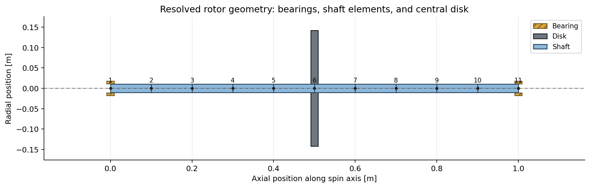
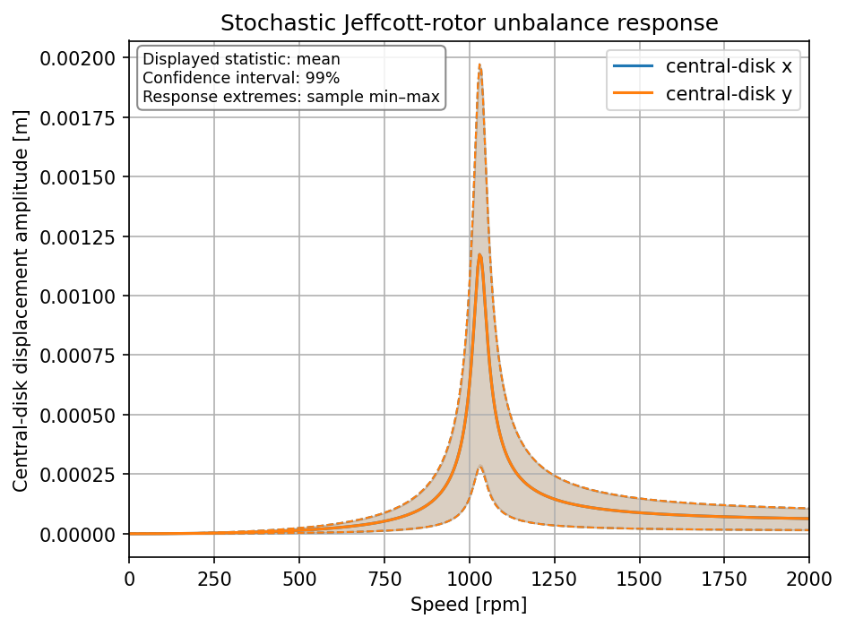
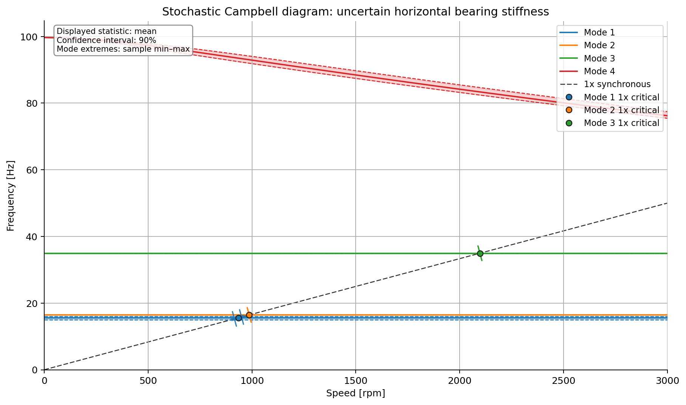

# Chapter 7 -- Plotting

## Table of contents

- [Installation](#installation)
- [Rotor longitudinal section](#rotor-longitudinal-section)
- [Frequency-response plots](#frequency-response-plots)
- [Campbell diagrams](#campbell-diagrams)
- [Synchronous harmonics and critical speeds](#synchronous-harmonics-and-critical-speeds)

## Installation

Matplotlib is a core Spinniped dependency and is installed automatically with
the package. Plotting functions are therefore available without an optional
installation extra.

## Rotor longitudinal section

`plot_rotor` draws the resolved longitudinal section of a `BuiltModel`. Shaft
outer and inner diameters are plotted in data units, so steps, solid sections,
and hollow sections follow the properties assigned to each shaft element.
Disk and bearing records do not contain manufacturing dimensions: disks are
therefore shown using an equivalent radius inferred from mass and polar
inertia, while disk width and bearing housings use conventional plot symbols.

<p align="center">
  
</p>

*A resolved two-bearing rotor. Grid labels make the finite-element mesh visible
without replacing the physical section.*

```python
from spinniped import plot_rotor

figure, axes = plot_rotor(model, show_grid_ids=True)
figure.savefig("rotor.png", dpi=150, bbox_inches="tight")
```

For a stochastic model, select the resolved realization with `sample=N`. Use
`ax=existing_axes` to add the section to an existing figure, `legend=False` to
hide the component legend, or `title=None` to preserve an existing axes title.
The function returns the figure and axes and does not call `show()`.

The longitudinal coordinate is the projection onto the model's `spin_axis`.
Every shaft must be parallel to that direction. A nonparallel shaft is rejected
because its true geometry cannot be represented by one longitudinal section.

## Frequency-response plots

`plot_frequency_response` accepts the result of either `frequency_response`
or `unbalance_response` and plots complex-response magnitudes. Select curves
with global DOF indices; the function resolves them through
`result["free_dofs"]`, so constraints do not change the selection convention:

```python
from spinniped import plot_frequency_response

result = solver.solve(
    "frequency_response",
    frequencies=[0.0, 10.0, 20.0, 30.0],
    speed=100.0,
    load_ids=[1],
)

figure, axes = plot_frequency_response(
    result,
    dofs=[0, 1],
    labels=["x response", "y response"],
)
```

Ordinary harmonic results default to excitation frequency in Hz. Synchronous
load and unbalance results contain one signed rotor speed per response point,
so their default horizontal axis is rotor speed in rpm:

```python
result = solver.solve(
    "frequency_response",
    speeds=speeds,
    load_ids=[synchronous_load_id],
)

figure, axes = plot_frequency_response(
    result,
    dofs=[0],
    speed_unit="rad/s",
)
```

Use `x_axis="frequency"` to show the order-derived excitation frequency
instead, or `x_axis="speed"` to require a complete speed grid explicitly.
Available speed units are `"rpm"`, `"rad/s"`, and `"hz"`.

For stochastic results, `statistic="sample"` selects one realization. Mean
and median curves, empirical confidence bands, and sample extrema use the same
options as Campbell plots:

```python
figure, axes = plot_frequency_response(
    result,
    dofs=[0],
    statistic="mean",
    confidence=0.90,
    show_extremes=True,
)
```

<p align="center">
  
</p>

*Example 11 propagates uncertainty in residual-unbalance magnitude through the
synchronous response. The solid curves show the sample mean, the shaded region
is the central empirical 99% interval, and the dashed curves bound the full
50-realization ensemble. The uncertainty changes the response amplitude
without shifting the resonant speed; the symmetric rotor's x and y responses
overlap.*

Statistics are calculated from response magnitudes, not by averaging complex
phasors. Use `ax=existing_axes` to combine response curves or add secondary
information. The function returns its figure and axes and does not call
`show()`.

## Campbell diagrams

`plot_campbell` accepts the result dictionary returned by the Campbell solver.
It plots one line per modal branch and defaults to rotor speed in rpm:

```python
from spinniped import plot_campbell

result = solver.solve(
    "campbell",
    speeds=[0.0, 100.0, 200.0],
    modes=8,
)

figure, axes = plot_campbell(result)
figure.savefig("campbell.png", dpi=150, bbox_inches="tight")
```

For a stochastic result, plot the mean or median branch together with an
empirical confidence band and the sampled minimum and maximum:

```python
figure, axes = plot_campbell(
    result,
    statistic="mean",       # alternatively "median"
    confidence=0.95,        # central 2.5th--97.5th percentile band
    show_extremes=True,
)
```

<p align="center">
  
</p>

*Bearing-stiffness uncertainty propagated through a Campbell analysis. Solid
curves are sample means, shaded regions are central 90% intervals, dashed
curves are sample extremes, and the diagonal bars show critical-speed
uncertainty along the 1x line.*

The default `statistic="sample"` plots one realization selected with
`sample=N`. Use `speed_unit="rad/s"` or `speed_unit="hz"` to change the
horizontal axis, and `ax=existing_axes` to draw into an existing layout. The
function returns the figure and axes and does not call `show()`, leaving
display and file output under caller control. Confidence bands are empirical
sample quantiles; they do not assume normally distributed frequencies.

Campbell modes are tracked by default. The solver uses displacement-vector MAC
to match each branch to the preceding speed and stores that choice in
`result["track_modes"]`. If the analysis is run with `track_modes=False`, the
plot still connects array columns, but those columns are independently sorted
at each speed and can exchange physical identity at a crossing.

## Synchronous harmonics and critical speeds

Request the desired harmonic indices $h$ during the Campbell solution, then
enable their display in the plot:

```python
result = solver.solve(
    "campbell",
    speeds=speeds,
    modes=8,
    harmonics=[1.0, 2.0],
)

figure, axes = plot_campbell(
    result,
    show_harmonics=True,
)
```

For a deterministic result or `statistic="sample"`, each finite critical speed
of the selected realization is marked on its harmonic line. For a stochastic
mean plot, the marker is the mean of the sample critical speeds and a diagonal
error bar along the harmonic represents one sample standard deviation. The
error bar has perpendicular end caps. Supplying
`confidence=0.95` makes this error bar span the empirical central 95% interval.
A median plot uses the median marker and shows an error bar only when a
confidence level is requested.

The legend identifies modal branches, synchronous harmonics, and critical-speed
markers. Confidence bands and critical-speed error bars are intentionally
excluded from it. A separate information box reports whether the displayed
central values are a sample, mean, or median and gives the confidence level
when one is active.

With `show_extremes=True`, the sample minimum and maximum of each modal branch
are drawn using the same dashed linestyle and branch color. They are omitted
from the legend; the information box instead reports that the sample min--max
extremes are displayed.

Set `show_critical_samples=True` to add every finite realization as a faint
point. Samples without that crossing are omitted rather than converted to
zero. Because frequency at a critical point is fixed by the harmonic index,
uncertainty lies along the synchronous line; the plot therefore uses a line
error bar rather than a two-dimensional ellipse.

`plot_campbell` only visualizes the crossings stored by the solver. Neither the
solver nor the plotting function refines the speed discretization, so selecting
adequately spaced speed samples remains the user's responsibility. Set
`show_critical_speeds=False` to draw harmonic lines without their intersections.
